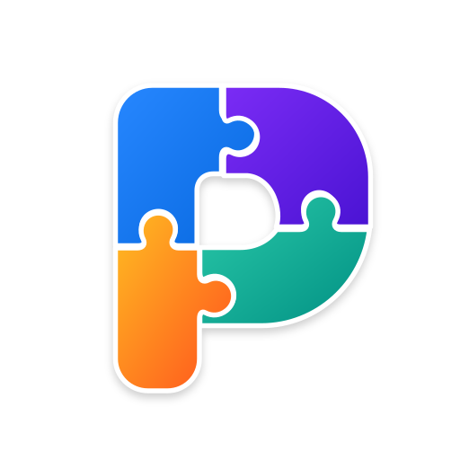

<p align="center">
  
</p>

<h1 align="center">Puzzle UI</h1>

<p align="center">
  TypeScript and React packages for building interfaces, themes, and application
  infrastructure.
</p>

<p align="center">
  <a href="https://puzzle-ui.com">Website</a> ·
  <a href="https://puzzle-ui.com/docs/getting-started">Documentation</a> ·
  <a href="https://puzzle-ui.com/docs/getting-started">Getting started</a> ·
  <a href="https://github.com/senorprogramador/puzzle">GitHub repository</a>
</p>

## Badges

[](./LICENSE)
[](https://www.npmjs.com/package/@puzzle-ui/ui)

[](https://github.com/senorprogramador/puzzle/actions/workflows/ci.yml)

The CI workflow builds packages, type-checks the workspace, runs package tests, and builds the documentation site. Build and test results are part of the same workflow rather than separate status checks.

## Introduction

Puzzle UI is a TypeScript-first ecosystem of independently installable React
packages. Its UI component library and theme system provide interface
building blocks; separate packages provide reusable hooks, icons, composed
page sections, SEO utilities, authentication and session primitives, storage
adapters, framework integrations, and project scaffolding.

The UI library is one part of this wider application ecosystem. Puzzle is not a
router or a general-purpose application framework, and applications do not need
to install every package. Compatibility and API maturity are documented at the
package or component level. The UI packages target React 19.

## Features

- **UI components** — composable React components with typed APIs.
- **Theme system** — theme provider, design tokens, colors, and typography.
- **Hooks and icons** — reusable React behavior and Iconify-powered icons.
- **Page sections** — composable layouts and presets for common page sections.
- **Accessibility** — component-specific semantics and interaction guidance;
  behavior and coverage vary by component and consuming application.
- **SEO** — metadata, structured data, sitemap, and robots utilities.
- **Authentication and sessions** — authentication primitives and session
  management, with client, server, and framework integration entry points.
- **Storage** — storage contracts with Cloudflare D1 and MongoDB adapters.
- **Full-stack utilities** — framework-specific integration packages for
  authentication and SEO workflows.
- **CLI** — an interactive generator for React, Next.js App Router, and TanStack
  Start projects.

These are package capabilities, not a claim that every feature or framework
combination has the same maturity or support guarantees. Check individual
component and package documentation for implementation and accessibility
details.

## Ecosystem

The packages below are published to npm and can be installed independently.
They are pre-1.0; check each package's documentation before adopting it.

| Package | Availability | Purpose | Install | Documentation |
| --- | --- | --- | --- | --- |
| [`@puzzle-ui/core`](https://www.npmjs.com/package/@puzzle-ui/core) | npm | Framework-independent shared utilities | `npm install @puzzle-ui/core` | [Getting started](https://puzzle-ui.com/docs/getting-started) |
| [`@puzzle-ui/hooks`](https://www.npmjs.com/package/@puzzle-ui/hooks) | npm | Reusable React hooks | `npm install @puzzle-ui/hooks` | [Hooks](https://puzzle-ui.com/docs/hooks) |
| [`@puzzle-ui/icons`](https://www.npmjs.com/package/@puzzle-ui/icons) | npm | Iconify-powered React SVG icons | `npm install @puzzle-ui/icons` | [Icons](https://puzzle-ui.com/docs/icons) |
| [`@puzzle-ui/theme`](https://www.npmjs.com/package/@puzzle-ui/theme) | npm | Theme provider, tokens, colors, and typography | `npm install @puzzle-ui/theme` | [Theme](https://puzzle-ui.com/docs/theme) |
| [`@puzzle-ui/ui`](https://www.npmjs.com/package/@puzzle-ui/ui) | npm | Composable React UI components | `npm install @puzzle-ui/ui` | [UI components](https://puzzle-ui.com/docs/ui) |
| [`@puzzle-ui/pieces`](https://www.npmjs.com/package/@puzzle-ui/pieces) | npm | Composed React sections and page layouts | `npm install @puzzle-ui/pieces` | [Pieces](https://puzzle-ui.com/docs/pieces/components/hero) |
| [`@puzzle-ui/seo`](https://www.npmjs.com/package/@puzzle-ui/seo) | npm | Metadata, structured data, sitemaps, and robots utilities | `npm install @puzzle-ui/seo` | [SEO](https://puzzle-ui.com/docs/seo) |
| [`@puzzle-ui/auth`](https://www.npmjs.com/package/@puzzle-ui/auth) | npm | Framework-independent authentication primitives | `npm install @puzzle-ui/auth` | [Authentication](https://puzzle-ui.com/docs/auth) |
| [`@puzzle-ui/session`](https://www.npmjs.com/package/@puzzle-ui/session) | npm | Session management for Puzzle Auth | `npm install @puzzle-ui/session` | [Authentication](https://puzzle-ui.com/docs/auth) |
| [`@puzzle-ui/storage`](https://www.npmjs.com/package/@puzzle-ui/storage) | npm | Storage contracts for authentication and sessions | `npm install @puzzle-ui/storage` | [Storage](https://puzzle-ui.com/docs/storage) |
| [`@puzzle-ui/storage-d1`](https://www.npmjs.com/package/@puzzle-ui/storage-d1) | npm | Cloudflare D1 storage adapter | `npm install @puzzle-ui/storage-d1` | [Storage](https://puzzle-ui.com/docs/storage) |
| [`@puzzle-ui/storage-mongodb`](https://www.npmjs.com/package/@puzzle-ui/storage-mongodb) | npm | MongoDB storage adapter | `npm install @puzzle-ui/storage-mongodb` | [Storage](https://puzzle-ui.com/docs/storage) |
| [`@puzzle-ui/fullstack`](https://www.npmjs.com/package/@puzzle-ui/fullstack) | npm | Auth client, server handlers, and Next.js/TanStack Start adapters | `npm install @puzzle-ui/fullstack react react-dom` | [Full-stack auth](https://puzzle-ui.com/docs/fullstack) |
| [`@puzzle-ui/create`](https://www.npmjs.com/package/@puzzle-ui/create) | npm | Interactive React project generator | `npx @puzzle-ui/create` | [Create a project](https://puzzle-ui.com/docs/create) |

The repository also contains the [documentation site](apps/site) and a
[Storybook playground](apps/playground). See the
[API stability audit](docs/api-stability-audit.md) for current UI and Pieces
component maturity classifications.

## Installation

Install only the published packages your application uses. For example, add
the component library and theme system with npm:

```bash
npm install @puzzle-ui/ui @puzzle-ui/theme
```

For a new project, run the published generator without installing it globally:

```bash
npx @puzzle-ui/create
```

The package table above links to each npm package and its installation command.
The generator also supports Bun, pnpm, and Yarn; see the
[Create a Project guide](https://puzzle-ui.com/docs/create) for its
requirements and options.

## Quick start

### Create a project

Run the interactive generator with your package manager:

```bash
npx @puzzle-ui/create
# or: bunx @puzzle-ui/create
# or: pnpm dlx @puzzle-ui/create
```

The generator offers Basic React with Vite, Next.js App Router, and TanStack
Start templates. It configures the Puzzle theme and can optionally add Tailwind
CSS. The CLI requires Node.js 20.19 or later.

See the [Create a Project guide](https://puzzle-ui.com/docs/developer/create-project)
for the generated files and setup options.

### Add UI components to an existing React app

Install the UI and theme packages:

```bash
npm install @puzzle-ui/ui @puzzle-ui/theme
```

Wrap the application in `Theme`, then import components from `@puzzle-ui/ui`:

```tsx
import { Theme } from "@puzzle-ui/theme";
import { Button } from "@puzzle-ui/ui";

export const App = () => (
  <Theme theme="system">
    <main>
      <h1>Welcome to Puzzle</h1>
      <Button>Get started</Button>
    </main>
  </Theme>
);
```

The bundler must support CSS imports. Puzzle components import their styles
themselves. See [Getting started](https://puzzle-ui.com/docs/getting-started)
for theme configuration and further examples.

## Framework support

- **React 19:** UI packages declare React 19 peer dependencies.
- **Generated templates:** `@puzzle-ui/create` offers Basic React with Vite,
  Next.js App Router, and TanStack Start templates.
- **SEO adapters:** `@puzzle-ui/seo` documents adapters for Next.js, TanStack
  Start, and React Router.
- **Authentication adapters:** `@puzzle-ui/fullstack` provides client/server
  entry points and adapters for Next.js and TanStack Start.

The repository CI builds and tests packages on Node.js 22 and 24. This is not a
framework compatibility matrix: the project does not publish blanket support
for every browser, rendering mode, framework version, or framework/package
combination. Check the relevant package documentation and test the target
application. No additional framework integrations are currently marked as
planned; see the [roadmap](./ROADMAP.md).

## Examples

The quick start above shows a minimal themed application. The documentation
includes interactive component examples, including [Button](https://puzzle-ui.com/docs/ui/actions/button),
[Card](https://puzzle-ui.com/docs/ui/data-display/card), and
[Text Input](https://puzzle-ui.com/docs/ui/forms/text-input).

Run the local component playground with:

```bash
bun run dev
```

Or start Storybook with `bun run storybook`.

## Documentation

- [Documentation home](https://puzzle-ui.com/docs/getting-started)
- [Getting started](https://puzzle-ui.com/docs/getting-started)
- [UI components](https://puzzle-ui.com/docs/ui)
- [Theme and design tokens](https://puzzle-ui.com/docs/theme)
- [Hooks](https://puzzle-ui.com/docs/hooks)
- [Icons](https://puzzle-ui.com/docs/icons)
- [Page sections](https://puzzle-ui.com/docs/pieces/components/hero)
- [SEO](https://puzzle-ui.com/docs/seo)
- [Authentication](https://puzzle-ui.com/docs/auth)
- [Storage](https://puzzle-ui.com/docs/storage)
- [Full-stack integrations](https://puzzle-ui.com/docs/fullstack)
- [Project generator](https://puzzle-ui.com/docs/create)
- [Tutorials](https://puzzle-ui.com/docs/tutorials)
- [API stability notes](./docs/api-stability-audit.md)
- [Contributing guide](./CONTRIBUTING.md)
- [Testing guide](https://puzzle-ui.com/docs/developer/testing)
- [Security policy](./SECURITY.md)
- [Code of Conduct](./CODE_OF_CONDUCT.md)
- [Roadmap](./ROADMAP.md)
- [Changelog](./CHANGELOG.md)

## Project status

Puzzle is under active development and its packages are currently pre-1.0.
Unless an API is explicitly marked Stable, it may change, including in
backward-incompatible ways. Documentation and examples may lag behind
implementation, and tests do not cover every use case.

There is no formal supported-version policy or published milestone schedule.
Open issues and discussions are the place to follow or propose work:
[GitHub Issues](https://github.com/senorprogramador/puzzle/issues) ·
[GitHub Discussions](https://github.com/senorprogramador/puzzle/discussions).

## Contributing

Contributions, bug reports, and suggestions are welcome. For a substantial
change, open an issue or discussion first. Bug reports are most useful when
they include the affected package, a minimal reproduction, expected and actual
behavior, and relevant framework and runtime versions.

See the [contributor guide](./CONTRIBUTING.md) for development requirements
and verified repository commands.

To develop locally:

```bash
git clone https://github.com/senorprogramador/puzzle.git
cd puzzle
bun install
```

Useful repository commands:

```bash
bun run build
bun run typecheck
bun run test:all
bun run --filter "@puzzle-ui/site" test:sitemap
bun run seo:validate
bun run --filter "@puzzle-ui/site" build
```

The full test command includes browser tests and MongoDB integration tests;
Playwright's Chromium browser and Docker Compose are required. See the
[contributing](https://puzzle-ui.com/docs/developer/contributing) and
[testing](https://puzzle-ui.com/docs/developer/testing) guides for package-level
commands and repository conventions. `seo:validate` also runs a live endpoint
smoke check against the canonical site; see the
[SEO/GEO validation report](docs/seo-geo-validation-report.md) for a local
production-build invocation.

For the current implementation inventory and follow-up process, see the
[SEO/GEO audit](docs/seo-geo/implementation-audit.md),
[implementation report](docs/seo-geo/implementation-report.md),
[external authority checklist](docs/seo-geo/external-authority-checklist.md),
and [monitoring guide](docs/seo-geo/monitoring-guide.md). The site also
provides `/.well-known/puzzle.json` with verified public project and package
facts when this version is deployed.

## Security

Please report security concerns privately. Read the
[security policy](./SECURITY.md) before reporting; do not post exploitable
vulnerability details in a public issue.

## License

Puzzle UI is released under the [MIT License](./LICENSE).
