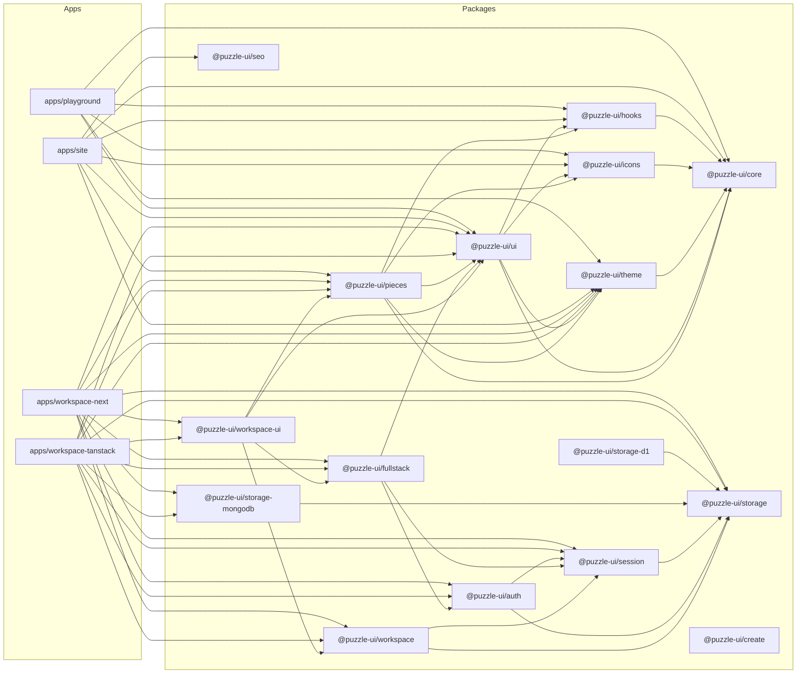

# Puzzle repository architecture

Puzzle is a TypeScript and React ecosystem designed for both human developers and AI-assisted application development. Its independently adoptable packages cover UI primitives, composed page sections, design tokens and theming, hooks and utilities, authentication and sessions, database-neutral storage contracts and adapters, framework integrations, SEO, and application scaffolding.

## Monorepo organization

The root [`package.json`](../../../package.json) defines the Bun workspaces. At the time this index was written, expanding those patterns discovers 20 workspaces: 4 applications and 16 packages. The root manifest and each matched package manifest are authoritative; package names come from each manifest's `name`, not its directory.

- [`apps/`](../../../apps/) contains the documentation site, component playground, and two Workspace examples.
- [`packages/`](../../../packages/) contains published libraries and private packages shared by the sample apps.
- [`docs/`](../../) contains repository architecture and engineering notes.
- [`.github/workflows/`](../../../.github/workflows/) contains CI and project-generation E2E workflows.

The [package map](./package-map.md) records each current workspace's responsibility, actual name, public entry points, direct dependencies, documentation, tests, and runtime boundary. The [dependency map](./dependency-map.md) records direct workspace edges by dependency type.

## Architectural layers

1. **Shared foundations:** `@puzzle-ui/core` supplies framework-independent utilities and rendering contracts; `@puzzle-ui/hooks` supplies React hooks; `@puzzle-ui/icons` supplies React icons.
2. **Design system:** `@puzzle-ui/theme` owns theme tokens and providers; `@puzzle-ui/ui` provides reusable components; `@puzzle-ui/pieces` composes larger page sections from the design system.
3. **Application services:** `@puzzle-ui/storage` defines database-neutral contracts; `@puzzle-ui/storage-d1` and `@puzzle-ui/storage-mongodb` implement adapters; `@puzzle-ui/session` and `@puzzle-ui/auth` provide session and authentication services.
4. **Integration and tooling:** `@puzzle-ui/fullstack` separates auth client, server, and framework adapter entry points; `@puzzle-ui/seo` provides metadata, structured data, sitemap, robots, and framework entry points; `@puzzle-ui/create` scaffolds applications.
5. **Workspace examples:** private `@puzzle-ui/workspace` shares Workspace domain contracts/services; `@puzzle-ui/workspace-ui` provides its React UI. The Next.js and TanStack Start apps provide framework-specific application wiring.

## Direct runtime workspace dependencies

In the diagram, an arrow points from a consumer to a direct runtime dependency also present in the Bun workspace. These are manifest relationships, not suggested or transitive connections. Workspace dependencies used only for development are documented separately in the [dependency map](./dependency-map.md).

`@puzzle-ui/seo`, `@puzzle-ui/create`, and `@puzzle-ui/storage` have no direct runtime dependency on another workspace package; their external dependencies and public exports are listed in the [package map](./package-map.md).

## Application architecture

- **`apps/site` (`@puzzle-ui/site`):** the Fumadocs documentation site built on TanStack Start and Vite. It consumes the UI, Pieces, Theme, Hooks, Icons, and SEO packages.
- **`apps/playground` (`@puzzle-ui/playground`):** a Vite application and Storybook playground for UI packages.
- **`apps/workspace-next` (`workspace-next`):** the Next.js App Router example, with server routes and browser UI backed by the shared Workspace packages and MongoDB adapter.
- **`apps/workspace-tanstack` (`workspace-tanstack`):** the TanStack Start counterpart, using the same domain and UI packages.

The Workspace apps are parity-focused examples, not evidence that every package supports every framework or deployment. See [`docs/workspace/architecture.md`](../../workspace/architecture.md) and [`docs/workspace/apps.md`](../../workspace/apps.md) for their shared domain and application boundaries.

## Framework integrations and client/server boundaries

- `@puzzle-ui/fullstack` exports separate `auth/client`, `auth/shared`, and `auth/server` entries, plus `auth/next` and `auth/tanstack` adapters. React is required; Next.js and TanStack Start are optional framework peers.
- `@puzzle-ui/ui` exposes generic rendering entries plus explicit Next.js and TanStack client/server/shared subpaths. Use the entry point matching the rendering environment.
- `@puzzle-ui/workspace` keeps client-safe contracts at its root and `/client` entry; server storage initialization and services are available only from `/server`. The Workspace apps inject verified identity and configured storage.
- `@puzzle-ui/auth`, `@puzzle-ui/session`, and database adapters are server-side infrastructure. Do not import them into browser bundles.
- `@puzzle-ui/pieces` is router-independent and can render static sections on the server; interactive sections require an appropriate client boundary in frameworks that distinguish server and client components.
- `@puzzle-ui/seo` separates its shared, React, server, and framework-specific public subpaths. Consult its manifest and docs instead of assuming an adapter's dependency requirements.

## Build and test infrastructure

- **Workspace/package builds:** Bun workspaces orchestrate package scripts. Most libraries use `tsdown` to emit ESM, CommonJS, and declarations. The root `bun run build` first checks generated SEO schema data, then builds packages under `packages/`.
- **Applications:** Vite builds the site, playground, and TanStack Start app; Next.js builds the Next app. App-level scripts are defined in each app manifest. Root `bun run typecheck` covers packages and the site, not every application.
- **Tests:** package suites use Vitest, Node's test runner, or Bun's test runner. UI and Pieces include Playwright-backed browser projects; Workspace apps have rendering tests; site scripts test docs, SEO, tutorials, and hydration. MongoDB adapter integration tests use Docker Compose. `@puzzle-ui/create` has a generated-project E2E suite that also requires network access.
- **CI:** [`.github/workflows/ci.yml`](../../../.github/workflows/ci.yml) builds, type-checks, installs Chromium, runs `bun run test:all`, and builds the site. The separate Create E2E workflow is in [`.github/workflows/create-e2e.yml`](../../../.github/workflows/create-e2e.yml).

For exact validation commands, environment requirements, and package selectors, see the [testing guide](../../../apps/site/content/docs/developer/testing.mdx) and package manifests.
