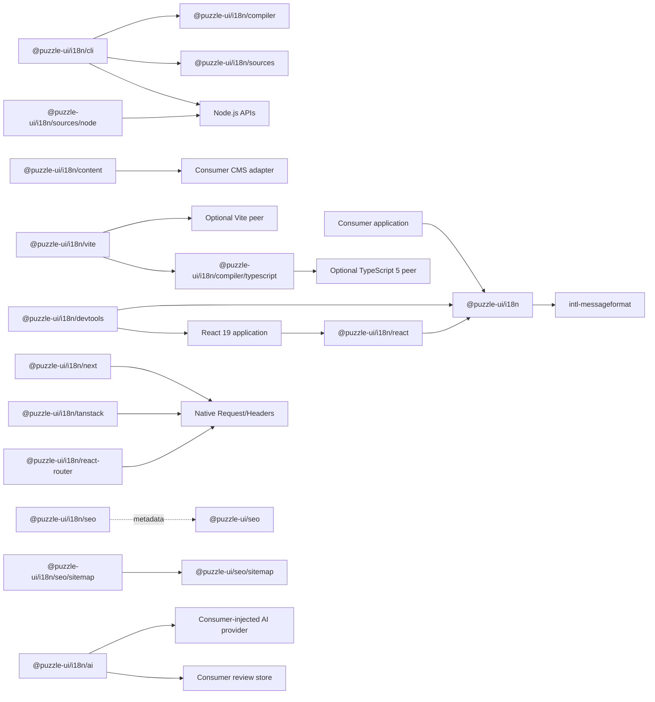

# Multilingual dependency graph

The current package is intentionally standalone in the workspace graph. Its
ICU dependency is external, and React is an optional peer available only to the
`/react` subpath.

`@puzzle-ui/i18n/seo` does not import or replace the SEO engine. Framework
helpers stay framework-package independent, and the content/AI flows depend on
consumer-provided CMS and review-store adapters. Node APIs are isolated to the
CLI and `/sources/node` subpaths; HTTP uses platform `fetch`. Compiler scanning
and Vite integration stay behind optional peers. See the repository
[dependency map](../../../ai/architecture/dependency-map.md) for workspace
relationships.
